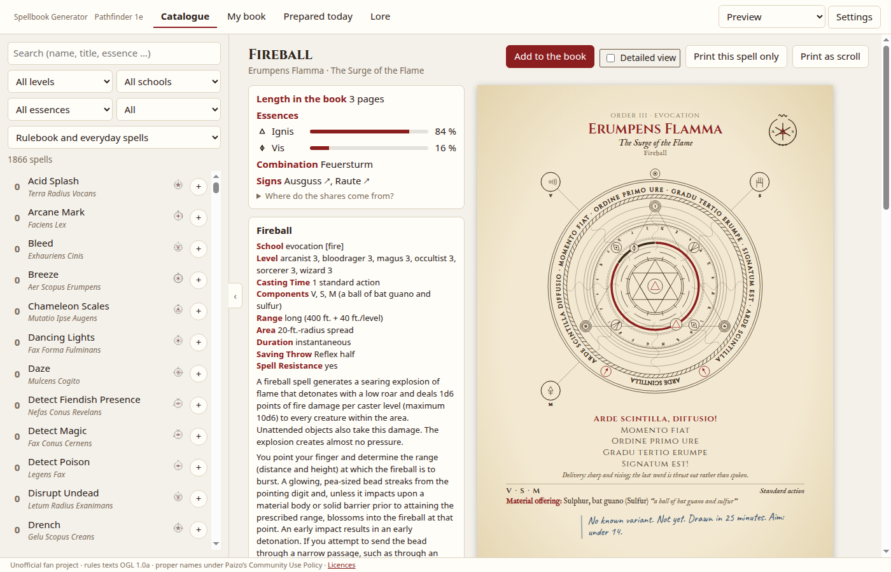
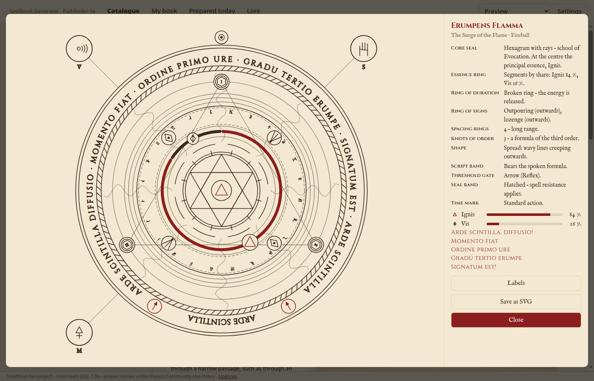
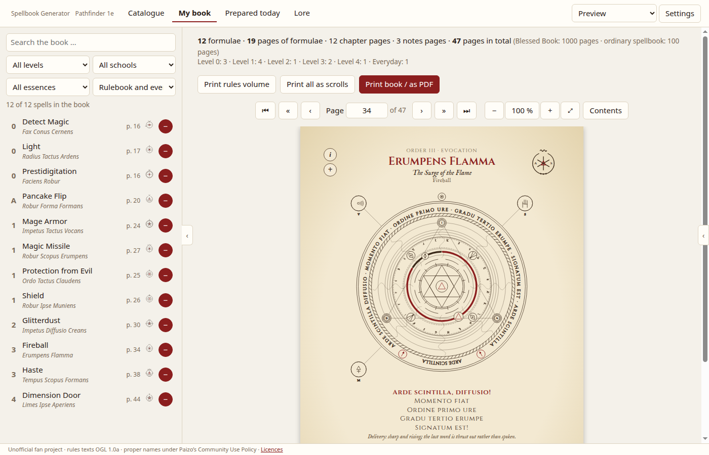
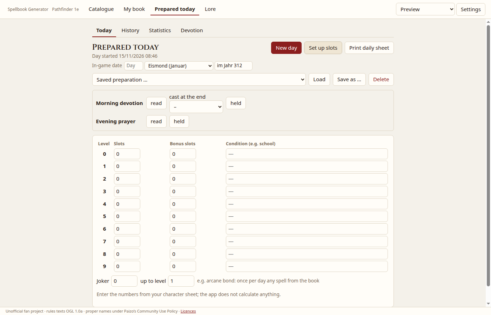
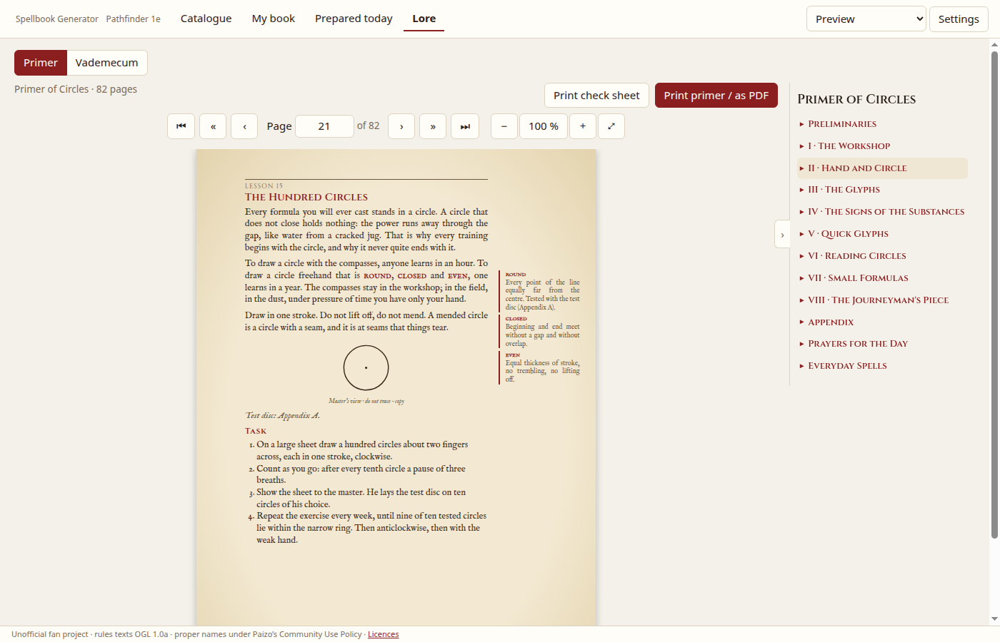
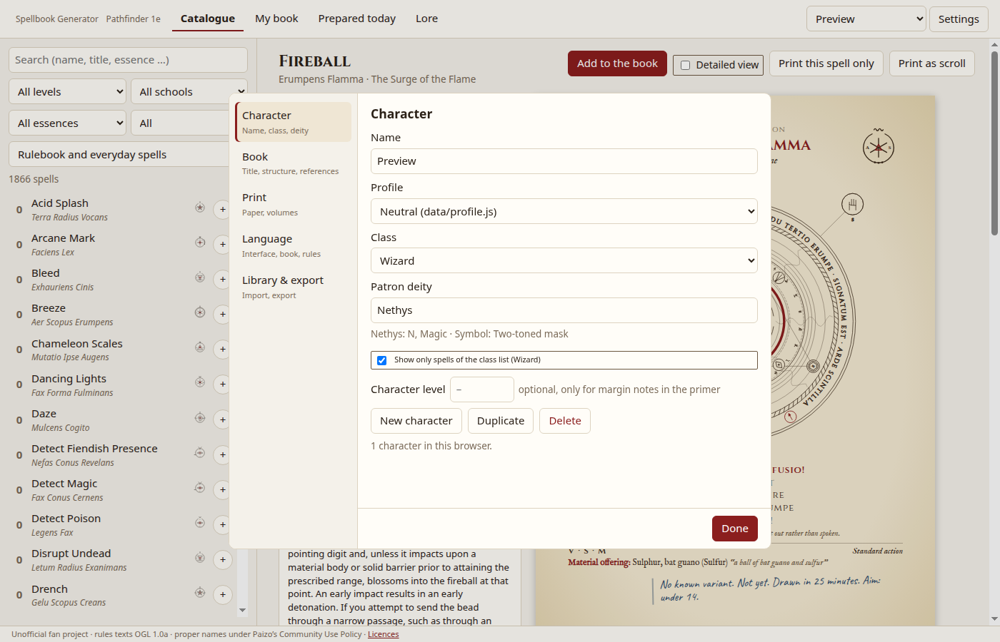
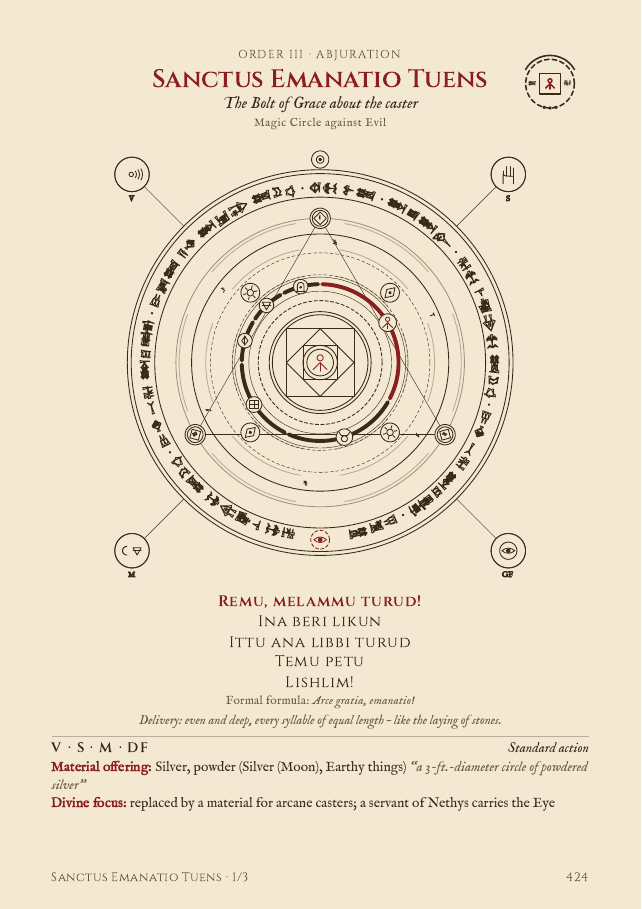
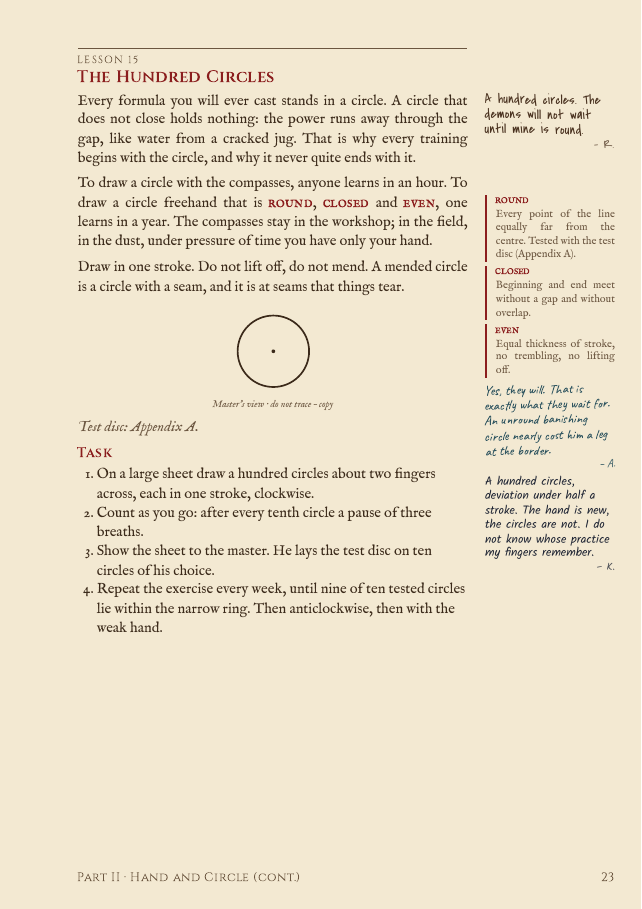
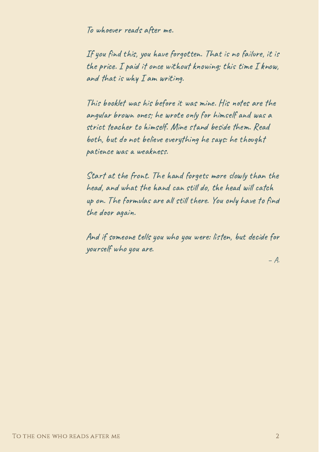

# Spellbook Generator – Guide

A tour of the app in ten minutes, and how to turn the neutral book into **your character's** book.

**Live version:** <https://famondir.github.io/spell-book-generator/>. The app starts in your browser's language (English or German, otherwise English); add `?lang=en` or `?lang=de` to the address to choose, or switch any time under *Settings → Language*.
Nothing to install, no account. Your book is stored in your browser only. If you like, you can [install it as an app](#install-as-an-app) and use it offline at the table.

**Contents:** [1. Find spells](#1-find-spells) · [2. Read a circle](#2-read-a-circle) · [3. Build and print your book](#3-build-and-print-your-book) · [4. Prepare spells for the day](#4-prepare-spells-for-the-day) · [5. Lore: primer and vademecum](#5-lore-primer-and-vademecum) · [6. Characters and settings](#6-characters-and-settings) · [7. Make it yours: the character profile](#7-make-it-yours-the-character-profile) · [8. Your own preview PDF](#8-your-own-preview-pdf) · [Install as an app](#install-as-an-app)

---

## 1. Find spells



The **Catalogue** tab lists every PF1e spell, plus about 70 *everyday spells*: tiny, harmless tricks like *Pancake Flip* or *Sock Match*.

- Search by name, in-world title or essence. Filter by level, school, essence and source (rulebook or everyday spells).
- Click a spell: on the left you see its rules and its **essences** (what the spell is "made of", e.g. Fireball = 84 % Ignis, 16 % Vis). On the right is the page as it will appear in your book.
- **Add to the book** (or **+** in the list) puts the spell into your book. **Detailed view** shows the long version of every page.

## 2. Read a circle



Click any circle to open it large. Every part means something, and the panel on the right explains it:

| Part of the circle | Tells you |
|---|---|
| Core seal (centre) | the school, e.g. a hexagram with rays = Evocation |
| Knots of order | the spell level (three knots = 3rd level, joined into a star from 3rd level up) |
| Spacing rings | range (one ring = touch … five = long range) |
| Ring of duration | instant (open), dashed (minutes), solid (hours) … |
| Threshold gate | the saving throw (arrow = Reflex, eye = Will …) |
| Seal band | hatching = spell resistance applies |
| Cornerstones | V, S, M, F (voice, gesture, material, focus) |
| Script band | the spoken formula, read clockwise from the north |

Press **Labels** in the dialog and every part of the circle gets a number, with its explanation listed beside it. **Save as SVG** exports the circle, for handouts or a prop. Similar spells get similar circles. After a few sessions you start recognising a fireball before you read the name.

**Learning to read circles.** You don't have to work it out alone:

- Every printed book starts with a **front matter** "How to read the circles": a worked example, all layers, the schools (the verb), the sixteen essences (the noun), the signs (the how), quick glyphs, alchemical materials and the affinity table of the schools.
- The **Primer of Circles** (tab *Lore*) teaches the system step by step, for drawing by hand.
- *Lore → Legend* has all symbols on one page for quick lookup.

**Quick glyphs.** The small symbol at the top right of every spell page is its **quick glyph**: the spell in five strokes instead of fifty, for when there is no time for the full circle. The outer ring shows the duration, a few strokes show the shape (ray, touch, burst …), the figure in the middle shows the school, and the marks around it come from the formula. The front matter explains them, and they are small enough to draw on an index card or a LARP prop.

## 3. Build and print your book



**My book** shows your book as it will be printed: page by page or as a spread, with a table of contents on the right and your spell list on the left (**−** removes a spell).

- **Already have a spell list?** *Settings → Library & export → Import list* reads an xlsx file with a column "Name", a csv or txt file (one spell per line) or a json export of the app. Use the English spell names; spells the app doesn't know are reported.
- Cantrips and everyday spells take half a page; a spell of level *n* takes *n* pages. The book is split into chapters by level, with a front matter that explains how to read the circles.
- **Print book / as PDF**: A5, A4 scaled, or A4 landscape with two pages per sheet. Use your browser's "Save as PDF" if you don't want paper.
- **Print rules volume**: a second book with the actual rules text, numbered like the table of contents, to lay next to the in-world book at the table.
- **Print all as scrolls**: one sheet per spell, circle on the front, formula and rules on the back (print double-sided).
- **A single spell:** open it in the *Catalogue* and use **Print as scroll** (one scroll, e.g. as loot to hand to a player) or **Print this spell only** (its book pages). The paper size for scrolls is under *Settings → Print*.
- Very big books can be split into **volumes** (*Settings → Book → maximum pages per volume*).

> Tip: bookmarks work. `#book/fireball` opens the book at Fireball, even after you've added more spells.

## 4. Prepare spells for the day



**Prepared today** is a small tracker for the table:

1. **Set up slots**: enter your slots per level by hand (the app does not compute anything from class or level), plus bonus slots with a condition (e.g. "school: abjuration") and joker slots (e.g. arcane bond).
2. Fill the slots with spells from your book. Tick them off as you cast.
3. **New day** after resting. Each game day gets an in-game date.
4. **Saved preparations** for your usual loadouts, a printable **daily sheet**, and under **History** / **Statistics**: your most-cast spells and "often prepared, rarely cast".

If your character has a patron deity, a morning devotion and an evening prayer appear here too.

## 5. Lore: primer and vademecum



The **Lore** tab holds the theory behind the circles:

- **Primer of Circles**: an apprentice's workbook that teaches the system lesson by lesson, from ink and quills to reading a full circle. It ends with the small formulas from your own book. Printable as a ring binder with punch margin, plus a **check sheet** for the GM ("master").
- **Vademecum**: if your character serves a deity, a small breviary of their church (prayers, hymns, feasts). Paladins and clerics get a **breviary** with stained-glass windows instead of a spellbook.
- **Legend**: all symbols, quick glyphs and the affinity table of the schools.

## 6. Characters and settings



Top right: choose the character. Each character has their own book, settings, preparation and log. In **Settings**:

- **Character**: name, profile, class, patron deity, character level (unlocks margin notes in the primer).
- **Book**: owner, title, rule references on the spell pages (rules-volume number, QR code to Archives of Nethys, source).
- **Print**: paper sizes, background on/off.
- **Language**: interface, book texts and rules each in English or German, feet or metres.
- **Character → Profiles**: export a profile as a file, load one from another device, remove stored ones (see *Taking your profile to another device* below).
- **Library & export**: import a spell list (xlsx with a "Name" column, csv, txt, json) and export everything as json, including preparations, the log and the character's profile. **Export regularly**: the browser is the only place your data lives.

---

## 7. Make it yours: the character profile

Out of the box the book is written by a nameless, neutral wizard. Everything personal comes from a **profile**:

- who owns the book, its title and subtitle
- **margin notes** in your character's voice, places where spells were practised, where formulas were learned
- **formula languages**: spells can be spoken in different tongues depending on *where* they were learned (in the example below, spells from the Worldwound are in Abyssal, those from Varisia in Thassilonian)
- calendar, months, holidays, star signs, a patron deity and their devotion
- the **primer** personalised: the master's name and preface, a handover letter, margin notes from several "hands" with their own handwriting and ink colour
- your own everyday spells and your own notes on existing ones

**See what that looks like:** a sneak preview of the books of Kirran, an android wizard in his third life, with notes in three hands: [English (PDF)](preview/kirran-preview-en.pdf) · [German, with pages of his Vademecum (PDF)](preview/kirran-preview-de.pdf).

<p>



</p>

### Step by step

Profiles are files on your computer, so for this you need a **local copy** (the hosted page can't read your files):

1. Download the repository: on GitHub **Code → Download ZIP**, unpack it (or `git clone`).
2. Copy `data/profile.local.example.js` to `data/profile.local.js`.
3. Fill it in, by hand or with an AI (below). Add `lang: "en"` if your profile is written in English.
4. Open `index.html` by double-click. In *Settings → Character → Profile*, choose your profile.

`data/profile.local.js` never leaves your computer, and Git ignores it if you work with a clone. For several characters, register several profiles under `window.PROFILES_LOCAL` (see the template).

### Taking your profile to another device

The profile file only exists on your computer, but the app can carry it as data. That's how it gets to your phone, a tablet or the hosted page:

1. Edit `data/profile.local.js` on your computer as usual and reload `index.html`.
2. *Settings → Character → Profiles*: press **Export** next to your profile. You get a file like `kirran.profile.json` with the profile and the Vademecum texts from `data/vademecum.local.js`.
3. On the other device, open the app, go to *Settings → Character → Profiles → Load profile …* and pick that file. The profile is now stored in that browser and can be chosen under *Profile* like one from a file.

**Even simpler:** *Settings → Library & export → Export list* puts the character's profile (and the Vademecum entry of its deity) into the export. Importing that one file on the other device brings book, preparation, journal **and** profile across.

When you change the profile, export it again and load it on the other device: a profile with the same name is **replaced**, not duplicated (the app asks first and shows both dates). On your computer the file always wins over a stored copy. The app never runs `.js` files you load, only `.json` profile packages it exported itself. Whoever gets an export file also gets the profile in it.

### Filling it with an AI

Give an AI assistant three things: `data/profile.js` (the neutral profile: shows every field), `data/profile.local.example.js` (a commented example) and a description of your character. A prompt that works well:

```text
You are helping me personalise an in-game spellbook generator for Pathfinder 1e.
Attached: data/profile.js (neutral profile, all fields) and data/profile.local.example.js (commented example).
Write data/profile.local.js for my character, in English, with lang: "en".

Character: <name>, <ancestry> <class> <level>, patron deity <deity or none>.
Background: <where they grew up, who taught them, key events>.
Campaign: <adventure path / setting, places that matter>.
Voice of the margin notes: <e.g. dry, self-ironic, precise, short sentences>.

Please fill: owner, bookTitle, subtitle, places, learningOrigins, everydayOrigins, notes (5–8, in the
character's voice, {essence} may be used), noteOriginalName, noteAlignment, a calendar if the setting
has one, and formulaOrigins (3–6 stations: place, formula language, share of the book in %, level range,
favoured schools/essences) that match the backstory. Optionally a primer section: master, preface,
voices, handover letter and notes for a few lessons.
Keep every field name and the JavaScript syntax exactly as in the example. Only output the file.
```

Then read what comes back. The AI gives you a first draft; the good margin notes are the ones you rewrite in your character's voice. Reload the page after each change. Without a profile the book stays neutral and works just the same.

Want a single spell completely hand-written? `data/custom_texts.js` lets you replace any generated text of a spell (formula, gestures, theory, notes).

## 8. Your own preview PDF

`tools/preview.mjs` typesets selected pages from book, primer and vademecum, one PDF per language, exactly as the print buttons do (needs Node ≥ 22, Chrome/Chromium and, for merging, `pdfunite` from poppler):

```sh
node tools/preview.mjs --spec tools/preview.example.json --list            # list pages to choose from
node tools/preview.mjs --spec tools/preview.example.json --out preview --png
```

The spec says which book, which character profile, which languages and which pages (`"title"`, `"spell:fireball"`, `"lesson:l13"`, `"#3+2"` …). The same tool takes the screenshots in this guide (`shots`).

---

*Rules text: Open Game Content under the OGL 1.0a (see [LICENSE-OGL.txt](../LICENSE-OGL.txt)).*

*Spellbook Generator uses trademarks and/or copyrights owned by Paizo Inc., used under Paizo's Community Use Policy ([paizo.com/licenses/communityuse](https://paizo.com/licenses/communityuse)). We are expressly prohibited from charging you to use or access this content. Spellbook Generator is not published, endorsed, or specifically approved by Paizo. For more information about Paizo Inc. and Paizo products, visit [paizo.com](https://paizo.com).*

---

## Install as an app

The live version can be installed on your phone, tablet or computer: its own icon, no browser bar, and it **works offline** after the first visit (the whole app, about 10 MB, is downloaded once, so use Wi-Fi the first time). With a connection, every start picks up the latest version.

- **Android (Chrome, Edge, Samsung Internet)** and **desktop Chrome/Edge**: *Settings → Library & export → Install as app*, or *Install app* / *Add to Home screen* in the browser menu.
- **iPhone/iPad (Safari)**: *Share → Add to Home Screen*.

Your books live in the browser, so the installed app starts **without your characters**. Bring them along with *Export list* (one file per character, including its profile) or *Character → Profiles → Export*, then import that file **in the installed app**. On Android the installed app shares its storage with Chrome, so anything already loaded in the browser tab is there too. **On iPhone and iPad the installed app has its own storage**, separate from Safari: load your files inside the app itself.

The double-click version (`index.html` from a download) can't be installed; browsers only install apps from a web address.

